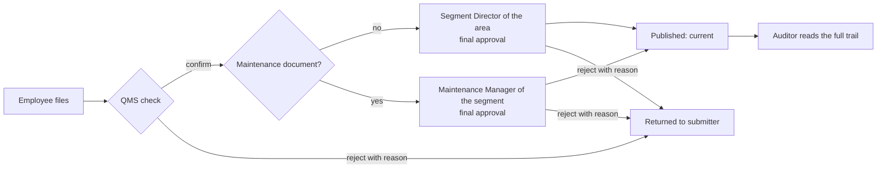
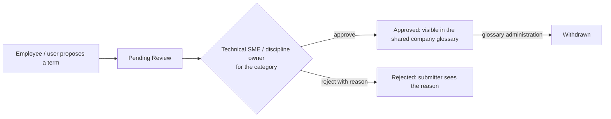

# TechHub business rules

The authoritative statement of how documents move through TechHub, for the team building the Azure back end. It describes the **current code** (`roles.js`, `store.js` and the pages that call them) including the owner's decisions of 1 October 2026 (`docs/QA/FIVE-ROLE-QA-AUDIT.md` §13). Section 12 lists every place where the code and the documentation disagree; nothing there was silently resolved. Sections 13 (Field Glossary) and 14 (Segment membership) are **target production requirements** set by the owner that the prototype does not implement.

> In the prototype every rule below runs in the browser and can be bypassed with the developer console. In production each one must be enforced by the API from the signed-in identity. See `AZURE-INTEGRATION-REQUIREMENTS.md` §4.

---

## 1. Personas

| Persona | Code key | Scope | In one sentence |
|---|---|---|---|
| Employee | `employee` | **target:** their operational segment(s) by membership, plus every Corporate Function, Center of Excellence and Company Wide, read (§14). *Prototype: every area* | Reads current documents, files new ones, sees what happened to their own submissions. |
| QMS / Document Controller | `qms` | every area | Checks every submitted document first, owns the register, withdrawal, periodic review and the F086 export. Never gives final approval. |
| Segment Director (also Function Head, Centre Manager, Corporate Sponsor, by area family) | `owner` | **one** area | Gives final approval to that area's **Operations** (non-maintenance) documents and manages them. |
| Maintenance Manager | `maintenance` | **one operational segment** | Gives final approval to that segment's **maintenance** documents and manages them. |
| External Auditor | `auditor` | every area, read | Reads everything, including drafts, withdrawn records and the register export. Changes nothing. |

The area a Director or Maintenance Manager holds belongs to the **person**, not the role: every area (25 in the register, including Company Wide) has its own holder. A Maintenance Manager can hold only an operational segment, because only operational segments have a maintenance department.

## 2. The two workflows

- **Operations:** Employee → QMS check → Segment Director → Published → Auditor.
- **Maintenance:** Employee → QMS check → Maintenance Manager → Published → Auditor.

Any role allowed to file (everyone except the Auditor) can start either workflow.

### Stages (`approvalStage`, only while `status = draft`)

| Stage | Meaning | Who acts | Moves to |
|---|---|---|---|
| `qms` | Filed, waiting on the QMS conformance check | QMS | `director` (confirm) or returned (reject) |
| `director` | Checked, waiting on final approval. The stage is named `director` for both workflows | the area's Segment Director, or for a maintenance document the segment's Maintenance Manager | `status = current` (approve) or returned (reject) |
| `null` | Released, returned, or never submitted | nobody | — |

A draft that shipped in the register without a stage is treated as `qms`. A returned draft (`rejected = true`) has no stage and sits in no queue.

## 3. What makes a document "Maintenance"

A document is a maintenance document if **either**:
1. `department = "maintenance"` (Upload's "Maintenance department document" box, ticked automatically when filing from a segment's Maintenance tab), **or**
2. `docType = "bulletin"` (Maintenance Bulletin), whatever the department field says.

(`TAQA_APPROVAL.isMaintenance`.) Everything else is an Operations document.

**Maintenance Bulletins exist only for operational segments** (owner's decision D8). Upload does not offer the type for a corporate function, centre or the company, and the register refuses one there: those areas have no Maintenance Manager, so a bulletin would have no valid final approver. Upload ticks and locks the maintenance box for a bulletin.

## 4. Authority, by persona

### QMS / Document Controller
- **Check** (stage `qms` → `director`): any document in any area. Records `countersignedBy/At`.
- **Reject** at the QMS stage, with a reason.
- **Withdraw** and **edit details** of any document in any area.
- **Never** gives final approval, including when acting under someone's delegation (delegations apply only to the role that holds them). Acting under a delegation, QMS has the delegation's authority only, which never includes the QMS check (§9).
- **Separation of duties (owner's decision, 4 Oct 2026; PI-31): SUBMITTER ≠ QMS CHECKER ≠ FINAL APPROVER.** Whoever filed a document may not do its QMS check or give it final approval; whoever did the QMS check may not give it final approval. Rejection is refused on the same terms. A delegate signs as themselves, so a delegate may approve the grantor's own filing. Desks and the Workbench do not offer a step the person may not take, and say why ("You filed this document, so someone else must…").
- Opens every desk, the Master List, Analytics and About; exports F086; bulk-confirms drafts at stage `qms` from the Master List (bulk confirm never publishes).
- **QMS's queue is company-wide.** The bell lists every document at stage `qms` from every area, each with its number, area (and Operations or Maintenance for an operational segment), what it is waiting for and when it was submitted. "Open your queue" and "+N more" open the Master List's **Waiting on QMS** view, which holds all of them. A Director's and a Maintenance Manager's queue stays their own area's desk.
- **QMS Workbench.** The Waiting on QMS view is where QMS works its queue. Opening a document there (or from a bell item, Home's "Check", or the link on any area desk) shows a check panel: number, type, area and department, revision, file, who submitted it and when, classification, next approver, and a warning when the same title is already in that area. QMS confirms or rejects from the panel (reject needs a reason of at least 20 characters) and steps to the next document. The panel calls the same register actions as the desks, which re-check the rules for that document; an auditor or any other role opening the same document sees the read-only record.
- **Bulk confirm** shows a preview first: every document that will be confirmed (title, number, area, current stage, next approver) and every selected document left out, with the reason. Only documents QMS may confirm now are included. Each is confirmed on its own, re-checked at that moment, and the result is shown per document. **Rejection is never bulk**: one document at a time, with its reason. *Azure: one server call and one audit entry per document; a document changed since the preview is refused, not confirmed.*

### Segment Director
- **Final approval** (stage `director` → `current`) only when **all** hold: the document's area is the Director's own area, and the document is **not** a maintenance document. Records `approvedBy/At`.
- **Reject** at the final stage under the same conditions.
- **Withdraw / edit details** of the area's **Operations** documents only.
- Opens their own area's desk and published list; refused on other areas' desks, the Master List, Analytics and About.

### Maintenance Manager
- **Final approval** only when the document's area is their own segment **and** it is a maintenance document.
- **Reject** at the final stage under the same conditions.
- **Withdraw / edit details** of the segment's **maintenance** documents only.
- Opens their own segment's desk (header "Maintenance Manager, ‹area›"; counters count maintenance documents only) and published list (maintenance documents only); refused elsewhere. Lands on the segment's Maintenance side.

### Employee
- Files documents. Reads current documents in the areas they can see: **target** their own operational segment(s) by membership plus every Corporate Function, Center of Excellence and Company Wide (§14); *the prototype shows every area*. Sees their own drafts' title and status ("Waiting on QMS check", "Returned by …: ‹reason›"); someone else's draft shows "Access restricted".
- No desk, no Master List, no Analytics or About, no withdraw, no edit.

### External Auditor
- Reads everything, including drafts, withdrawn records, every trail and the Master List; exports F086.
- **Cannot** file, check, approve, reject, withdraw, edit or delegate. The register refuses every write from this role.

## 5. Area restrictions
- A Director or Maintenance Manager acts only in the one area they hold. Another area's desk and published list refuse them; approval, rejection, withdrawal and edit refuse them.
- QMS and Auditor are not area-scoped (the Auditor only reads).
- **Target:** an Employee's reading is scoped by **segment membership** (§14): their own operational segment(s), every Corporate Function, every Center of Excellence and Company Wide, and no other operational segment. An employee with no membership sees no operational segment. *The prototype does not scope Employees.*
- **Target:** a Segment Director or Maintenance Manager reads the operational segment they hold, every Corporate Function, every Center of Excellence and Company Wide; holding a role gives **no** visibility of other operational segments (each needs an explicit membership, §14.2).
- **Target:** an Employee files only into areas they are authorised to see, enforced by the API (§14.3).
- Drafts: a scoped role sees drafts of its own area only.

## 6. Department restrictions (owner's decision, 1 Oct 2026)

| Withdraw / edit details | QMS | Segment Director (own area) | Maintenance Manager (own segment) | Another area's holder |
|---|---|---|---|---|
| Operations document | yes | **yes** | no | no |
| Maintenance document or bulletin | yes | no | **yes** | no |

Final approval follows exactly the same split.

## 7. Rejection and resubmission
- Rejection is allowed only to whoever may act at the current stage (QMS at `qms`, the right final approver at `director`).
- A reason of at least **20 characters** is required. The store refuses a shorter one, the same as the desk and the Workbench (PI-09).
- A rejected document keeps `status = draft`, gets `rejected = true`, `rejectedAtStage`, `rejectedBy/At/Date`, `rejectedReason`, and leaves both queues. It can never be checked or approved afterwards.
- The submitter sees "Returned by ‹role›: ‹reason›" in Upload's "Your submissions" and on the document page.
- **One file is one document.** Upload takes one controlled document at a time; selecting several files is refused with "Upload one controlled document at a time. Bulk upload will be supported separately." Several files are never bundled into one record. Real bulk upload (each file its own record, number and approval) is a separate, server-side feature not yet built.
- **Resubmission is a new filing**: the revised document is filed again from Upload and starts at stage `qms`. The returned record stays as history.
- **A returned first issue filed again keeps its number and revision** (owner's decision for PI-24, 5 Oct 2026). `TQ-…-SOP-009 Rev 1.0` attempt 1 returned → the corrected filing is `TQ-…-SOP-009 Rev 1.0` attempt 2, started from **File it again** on the returned record (Upload, "Your submissions", or the document page). Area, type and department stay those of the returned attempt. Attempt 1 stays in the register as history; attempt 2 is the only attempt in the workflow; when approved the released document is simply Rev 1.0. Each attempt has its own record id. A returned attempt does not consume a new number or a released revision number. A returned filing is **Returned**, not pending: it leaves both queues and every pending count when it is returned, and pages show it as Returned with who returned it, when and why.
- **A returned revision filed again is the same revision, next attempt** (owner's decision for NEW-03, 5 Oct 2026). Rev 2.0 returned and filed again is **Rev 2.0 (attempt 2)**, never Rev 3.0 and never a second record claiming to be Rev 2.0. Each attempt is its own record with a permanent record id (`recordId`) and an `attempt` number; the returned attempt keeps its reason and history; only the attempt that is released becomes the issued revision. Integrity rule: a number and revision are unique among the records that were not returned, and each attempt at a revision is one record.

## 8. Withdrawal and revision
- Withdrawing sets `status = obsolete`. The record stays in the register and every reader sees "Withdrawn, do not use". Download, print, offline pin and the quick-reference card are disabled for withdrawn documents.
- **A withdrawal is a permanent event on the record** (PI-11; owner's decision of 5 Oct 2026). A reason of at least 20 characters is required, the same floor as a rejection, and the register refuses one without. The record keeps who withdrew it (`withdrawnBy`), when (`withdrawnAt`, `withdrawnDate`), why (`withdrawnReason`) and the status it had (`withdrawnFromStatus`). Nothing else on it changes: its submission, check and approval history stay exactly as they were. A record withdrawn before it was ever in force (a draft, or an approval not yet effective) reads "Withdrawn, never in force" and its trail shows only the steps actually taken. Records withdrawn before RISE recorded withdrawals say that who and why were not recorded, rather than inventing it.
- **One selected row is one exact record** (PI-10). Bulk withdrawal acts only on the revisions in force that were ticked. Before anything happens it lists each revision that will be withdrawn, each open revision that will be cancelled with it (NEW-02), and each ticked row left out with the reason (a revision in progress, a returned filing, an approval not yet effective, one already withdrawn, or one the person does not manage). One reason is asked for and recorded on each. Each withdrawal is bound to the record listed, and one that changed since the list was shown is refused, never redirected to another revision. Single withdrawal from the published list works the same way.
- Withdrawing the revision in force also withdraws that document's translations in force (PI-34).
- **Withdrawing the revision in force cancels the revision in progress** (owner's decision for NEW-02, 5 Oct 2026). In the same step, any revision of that document still in progress (a draft not returned), and any revision in progress of its translations, becomes **Cancelled**: `status = obsolete`, `cancelled = true`, `cancelledReason = "Cancelled because the document family was withdrawn."`, `cancelledBy/At/Date`. It leaves the QMS and final-approval queues at once, can never be checked, approved or returned to Current, and stays in the register as history with its reason (it is not deleted). Pages show it as **Cancelled, never in force**; its trail shows only the steps actually taken and the cancellation. A stale page cannot revive it: the check and approval refuse a draft whose predecessor or source family has been withdrawn, as well as any decision bound to a record that is no longer the one waiting (§18).
- Changing a published document's content is a **new controlled revision** (PR 2A-2, PI-02):
  - **Same number, next revision.** `TQ-MECH-001 Rev 1.0` → `TQ-MECH-001 Rev 2.0`. Upload, "Revision / Update", choosing the document being revised. The register, not the filer, sets the revision (the next major: 1.0 → 2.0, v2.3 → v3.0), `supersedes = "Rev ‹old›"`, and carries over the document's type, area, department, scope, classification and translation link. A revision of a different type, area or department is refused.
  - **What may be revised.** Only the revision in force (`current` or `under-review`), or a translation waiting to be re-issued. A withdrawn or superseded document is not revised: a new document is filed instead.
  - **One open revision at a time.** While a revision of a number is in progress (a draft, not returned), another is refused. A returned (rejected) revision does not block a new one.
  - **One revision in force.** A revision goes through both release steps like any document. Its final approval, in the same step, makes it `current` and marks the revision it replaces `superseded` with `supersededBy = "Rev ‹new›"`. The superseded revision keeps every field it had (signatures, dates, trail): approval history is never rewritten. At no point are two revisions of one number in force.
  - **Which revision an action means.** The QMS check, final approval and rejection act on the number's open revision. Withdrawal and editing act on the revision in force unless a revision is named. Pages and links open the revision in force unless they name one (`&rev=`); the Master List, search results for drafts and "Your submissions" name it.
- **Translations follow their source** (PI-34). When a source's revision is released, its translations in force are marked `superseded` ("Source ‹number› Rev ‹new›: translation to be re-issued"); the translation is then re-issued as its own next revision under its own number. When the source is withdrawn or superseded by status, its translations in force follow.

## 9. Delegation
*Updated for PR 2C-2 (NEW-04, PI-32, PI-54) with the owner's decisions of 5 October 2026.*

- Only roles that hold `delegate` can grant: the **Segment Director** and the **Maintenance Manager**. Someone acting under a delegation cannot grant, revoke or re-delegate.
- **Two separate permissions, each named explicitly** (owner's decision, 5 Oct 2026):
  - **Approval**: give final approval (and return at that stage) in the grantor's place. Only if the grantor holds approval.
  - **Manage documents (edit details and withdraw)**: off by default. Only if the grantor holds it.
  - Approval does **not** bring management, and management does **not** bring approval. A grant recorded before this permission existed carries **no** management.
  - The QMS check is never delegable. QMS never gives final approval, delegated or not.
- **Scope, for every delegated action** (approve, return, edit, withdraw): the grantor's own area and department, and the grant's document types if it names any. A grant cannot name another area, another department, or a type the grantor never holds (a Director never holds maintenance bulletins; a Maintenance Manager never holds policies). Withdrawal stays subject to every record-truth and stale-action control (§8, §18, §19).
- **Dates are calendar dates** (`YYYY-MM-DD`), never UTC-midnight instants:
  - start and end are both required;
  - the start is today or later (no retroactive delegation);
  - the end is on or after the start;
  - at most **90 calendar days counting both the start and the end** (end ≤ start + 89).
  - A grant is valid for the **whole** of its end date and expired from the next day, whatever the time.
  - "Today" is the acting person's local calendar day. *Production: the server's (Microsoft 365) business date.*
- **State**: **Active**, **Scheduled** (starts later), **Expired** or **Revoked**. It follows from the dates and revocation; it is not edited.
- **Evidence (PI-54).** Every grant records:
  - an immutable grant id;
  - the grantor's identity and display name;
  - the delegate's display name, and the delegate's identity where it can be established (in the prototype it cannot: `delegateId` is null);
  - approval and management permissions;
  - area, department and document types;
  - start and end dates;
  - the reason (at least 20 characters, the same floor as returning or withdrawing);
  - created by (identity and name) and created at.
  - A delegate may not be named as the grantor, the grantor's title or a role.
- **Revocation** asks for confirmation. It ends the grant at once and records who revoked it and when (`revokedBy`, `revokedById`, `revokedAt`). The grant is never deleted or otherwise changed: revoked and expired grants stay listed on the desk as history.
  - Only the grantor, signed in as themselves in that area, revokes.
  - A tab still acting under a grant that was revoked, has expired, or was dropped in another tab holds **nothing** until it stops acting. It never falls back silently to someone else's authority.
- **Evidence on the record.** An action taken under a grant keeps, separately, the actor's label (`approvedBy`), the actor's identity (`approvedById`), the grant (`approvedUnderGrant`), the grantor's identity (`approvedOnBehalfOfId`), the time and the action itself (likewise `rejected…` and `withdrawn…`). Filing and the register export are not delegated: while acting under a grant a person cannot file, and stops acting to file as themselves.
- **Prototype limitation: storage is not tamper-proof.** Grants and revocations live in this browser's storage, which anyone at the keyboard can edit; for example, clearing a grant's `revokedAt` by hand would make it usable again here. The prototype does not pretend otherwise. *PRODUCTION CONTROL REQUIRED: grants, revocations and their evaluation are server-side and append-only; the client never decides.*
- **Legacy grants** (recorded before PR 2C-2) stay readable exactly as stored, labelled as recorded before RISE kept full delegation evidence, and are never rewritten.
- The signature records the delegate's label: "‹delegate› (delegate for ‹grantor›)". The record also keeps the actor's identity (`approvedById`) and, as evidence of the authority used, the grant id (`approvedUnderGrant`, `rejectedUnderGrant`, `withdrawnUnderGrant`). A grant id identifies a grant, never a person.
- Each desk lists and revokes only the delegations its own holder granted for that area.
- A delegation never creates or changes Segment Membership. A delegate outside the grantor's segment sees only the delegated queue and its documents, only while the delegation is valid (§14.10).
- A delegate opens the grantor's desk while acting under an active grant for that area, and sees only what the grant allows.
- Switching role or area drops any delegation being acted under. *(Prototype: "Act as this" on the grantor's own desk stands in for the delegate signing in. A grant can be taken up only in the session that made it, the same role, area and grantor identity; a value set from another role, area or the console is ignored.)*

## 10. Lifecycle-field protection
These fields change **only** through filing, check, approval, rejection and withdrawal, never by editing a record's details: `status`, `approvalStage`, `approvedBy`, `approvedDate`, `approvedAt`, `countersignedBy`, `countersignedDate`, `countersignedAt`, `rejected`, `rejectedAtStage`, `rejectedBy`, `rejectedReason`, `rejectedDate`, `rejectedAt`, `submittedBy`, `submittedAt`, the cancellation and withdrawal records (`cancelled*`, `withdrawn*`), the actor identities and grant references (`submittedById`, `countersignedById`, `approvedById`, `approvedUnderGrant`, `rejectedById`, `rejectedUnderGrant`, `withdrawnById`, `withdrawnUnderGrant`, `cancelledById`; NEW-04), `supersededAt`, `supersededDate`, `tookEffectAt` and `issueDate`. An edit that names any of them is refused, for every role including QMS. A filing never carries `issueDate`, `nextReviewDate` or `reviewOverdue`: the register sets them at release (§19).

Added by the Priority 1 integrity remediation (PI-09), each enforced by `store.js` and each a **server rule** for production:
- **Filing** always creates `status = draft` at stage `qms`. Any lifecycle field the caller sends is ignored, and `submittedBy` / `submittedAt` are stamped from the signed-in identity and the clock. Filing is also refused for: a Policy from anyone but QMS (as Upload already offered), more than one file (§7), and a maintenance department document outside an operational segment (§3).
- **Status moves** are an allow-list: withdraw (`obsolete`) from any status except `obsolete`; `superseded` only from `current` or `under-review`; `current` only through final approval. Nothing else, and nothing out of `obsolete`. A draft cannot be made `under-review`, and a current document cannot be sent back to draft.
- **Editing details** may change only `title`, `summary`, `keywords`, `audience`, `related`, `changeNote`, `nextReviewDate`, `reviewOverdue`, `language`. Number, area, department, type, revision, files, what it supersedes, classification and scope are identity or authority and change only by filing a new controlled revision.
- **Signatures** carry the signed-in identity only. No call accepts a signer name.
- **Whoever performed the QMS check on a document cannot give it final approval** (two people, never one; PI-04).
- No page can wipe the register (the prototype's `reset()` is no longer exported).

## 11. Reading rules (visibility)
- Withdrawn documents stay **visible** with a "do not use" banner (an old printed QR code must land somewhere), but cannot be downloaded, printed or pinned.
- Classifications: Employee sees `internal`; Director and Maintenance Manager `internal` and `confidential`; QMS and Auditor all, including `restricted`. A policy is always `internal` (TQ-QHSE-S001 5.5).
- A document page shows "Current, OK to use" only for `current` documents.
- **Target:** visibility also follows segment membership (§14). A document in an operational segment the user cannot see is treated as not found.

## 12. Where the code and the documentation disagree

| # | Discrepancy | Code does | Documentation says | Status |
|---|---|---|---|---|
| 1 | Who gives final approval for non-SOP types | The **area holder** (Segment Director / Function Head / Corporate Sponsor) approves any non-maintenance document in their area, whatever its type | The register's type table names other approvers: Manual "Subject Matter Expert", Lesson "QHSE Manager", Alert "Corp Function VP / Director", Policy "CEO". Upload's confirmation now names these, but the desk that receives the document is the area holder's | **Open business decision** for the owner and QHSE before the API encodes it |
| 2 | Release of a revision | Released the new revision and left the old one current | TQ-QHSE-S001 / API Q2 expect the old revision to be withdrawn when the new one is released | **Closed (PR 2A-2):** release supersedes the previous revision and its translations in the same step (§8) |
| 3 | Stage name | Final-approval stage is called `director` for both workflows | — | Naming only; the API may rename it (`final`) |
| 4 | Role descriptions | Fixed during the handover audit: the QMS and Director descriptions (shown on the Master List) said QMS countersigns after the Director | — | **Fixed** (wording only) |
| 5 | August 2026 documents (`AZURE-MIGRATION-RAFA.md`, `PLATFORM-FUNCTIONAL-SPEC.md`, `DT-HANDOVER-PLAN.md`) | Two-step release, five personas, department rules | Describe a Power Automate approval flow and "approvals change only the screen" | Marked **historical**; this document supersedes them for rules |
| 6 | Field Glossary contributions | Any user adds a term and it appears **immediately**, in this browser only, as a "Community" term. No review | Production requires a proposal → Pending Review → technical SME approval before a term is shared (§13) | **Target requirement set by the owner (1 Oct 2026)**; prototype behaviour is not the target |
| 7 | Segment Contributors / Add Contributor | The area desk (Director, Maintenance Manager, QMS) has "Segment Contributors" and "+ Add Contributor": free-text name and job title, a role of **Editor / Viewer / Owner**, demo names, kept for the browser session only. It grants nothing. Every Employee sees every area | Production uses **Segment Members / Add Member**: membership (segment + Operations or Maintenance department) only, resolved from Entra ID by email, no role choice; the Director manages Operations members, the Maintenance Manager Maintenance members, QMS all; Employees see only their own operational segment(s) plus Corporate Functions, Centers of Excellence and Company Wide (§14) | **Target requirement set by the owner (1 Oct 2026)**; the prototype UI was not renamed |
| 8 | Filer approving their own document (PI-31) | Nothing stopped the person who filed a document from checking or approving it | Silent | **Decided by the owner (4 Oct 2026) and enforced (PR 2A-3):** submitter ≠ QMS checker ≠ final approver (§4). **PRODUCTION CONTROL REQUIRED**: only the server knows who the filer really is |
| 9 | Software / Tool | Upload offered the type, but no number, owner or approver exists for it, so a filing could never complete (PI-33) | — | **Closed by the owner (4 Oct 2026):** not fileable until numbering, ownership and approver are defined (§16) |

## 13. Field Glossary contributions (target production requirement)

Owner's clarification, 1 October 2026. **Not implemented in the prototype**, and the prototype's behaviour must not be read as the target.

**Prototype today:** Field Glossary's "Add term" form (abbreviation and full name required, definition and field optional) adds the term at once. It is stored in this browser only (`localStorage` `taqa_glossary_custom`), labelled "Community", with no review and nobody else sees it.

**Production (Azure):**

1. **Propose.** Any signed-in user may propose a new term: term or abbreviation, full name, definition, category, and a source or reference where there is one. A proposal is saved as `pending` and is **not** visible in the shared glossary. The submitter can see their own proposals and their status.
2. **Review.** The **relevant technical SME / discipline owner** for the term's category reviews it and validates the terminology and the definition. They **approve** or **reject**. A rejection records a reason, which the submitter sees.
3. **Publish.** Only an `approved` term appears in the shared company glossary, for everyone.
4. **SME mapping.** Which SME or discipline owner reviews which category (Drilling, Well Control, Production, Safety & HSE, Engineering, Logging & Reservoir, Commercial, Maintenance, Human Resources, Cybersecurity, Document Control, General) is **defined by the business / IT implementation**, not by this prototype.
5. **QMS / Glossary administration.** Has company-wide administrative capability over the glossary register:
   - identify and remove duplicates
   - correct a term's category
   - manage and withdraw entries (`withdrawn`)
   - oversee the glossary register

   QMS is **not** automatically the technical approver of every field definition. Technical approval belongs to the category's SME. If QMS also acts as an SME for a category (for example Document Control), that comes from the SME mapping, not from the QMS role.
6. **Server-side.** Every step (propose, approve, reject, recategorise, withdraw) is enforced by the API from the signed-in identity, recorded with the actor and server time, and written to the audit trail.

Recommended for the implementation to confirm with the owner: a submitter does not review their own proposal; a proposal that duplicates an approved term is flagged to the reviewer; a correction to an approved definition goes through the same review; the built-in terms that ship with the prototype are loaded as `approved` seed data (source "TechHub prototype seed"), with the owner deciding whether SMEs re-validate them.

Entity: `DATA-MODEL.md` (GlossaryTerm). Endpoints: `API-REQUIREMENTS.md` §7. Acceptance: `AZURE-UAT-CHECKLIST.md` §8.

## 14. Segment membership (target production requirement)

Owner's clarifications, 1 October 2026 (the second one, on departments and the Maintenance Manager, replaces the first where they differ). **Not implemented in the prototype.** For Azure, the concept is called **Segment Members** and **Add Member**, replacing the prototype's "Segment Contributors" and "Add Contributor". Membership is organisational belonging and access, not a content-contributor permission.

### 14.1 Membership has two dimensions; role is separate

A membership is **operational segment + department**:

1. **Operational segment**, for example Coiled Tubing.
2. **Department / team** within that segment: **Operations** or **Maintenance**.

Example:

| | |
|---|---|
| Employee | `Mohammed.jahdali@tq.com` |
| Segment | Coiled Tubing |
| Department | Maintenance |
| Role | Employee |

| | Membership | Role |
|---|---|---|
| Answers | Which operational segment and team does this employee belong to, and therefore see? | What authority does this person have? |
| Example | Mohammed Jahdali → Coiled Tubing, Maintenance | Mohammed Jahdali → Employee |
| Example | Ali Example → Coiled Tubing, Maintenance | Ali Example → Maintenance Manager |
| Comes from | An authoritative company source if one exists (§14.6), otherwise Add Member | Trusted Entra ID / server-side role mapping only (`AZURE-INTEGRATION-REQUIREMENTS.md` §3) |

Both people above belong to Coiled Tubing Maintenance; they have different authority. **Membership never grants a role:**
- Adding someone as Coiled Tubing + **Maintenance** does **not** make them Maintenance Manager.
- Adding someone as Coiled Tubing + **Operations** does **not** make them Segment Director.
- QMS / Document Controller, Segment Director, Maintenance Manager and External Auditor come only from trusted Entra / server-side role mapping and cannot be assigned from Add Member. "Owner" can never be assigned from it.

Department membership primarily determines **team administration** (who manages the member, §14.5) and any department-specific experience or routing (for example landing on the segment's Maintenance side). It does **not** itself grant approval authority.

### 14.2 What each person sees

| Person | Sees |
|---|---|
| Employee with a membership (either department) | Their member segment(s), both Operations and Maintenance sides; every Corporate Function; every Center of Excellence; Company Wide |
| Employee with **no** operational-segment membership | Every Corporate Function; every Center of Excellence; Company Wide. **No operational segment** until an explicit membership is added |
| Segment Director / Maintenance Manager | The operational segment they hold / manage; every Corporate Function; every Center of Excellence; Company Wide; plus any segment where they hold an explicit additional membership |
| QMS / authorised administration | Every area, as their role requires |
| External Auditor | Every area, as their role requires (read only) |

Holding a role (Segment Director, Maintenance Manager) does **not** automatically give visibility of other operational segments; any other segment needs an explicit additional membership (§14.8). Nobody sees an operational segment because of a URL, a link or a search result alone.

### 14.3 What a normal member can and cannot do
A segment member is still an **Employee**, whichever department. They can:
- view their assigned operational segment, the Corporate Functions, the Centers of Excellence and Company Wide
- submit / upload documents through the normal controlled workflow (QMS check, then final approval), **only into areas they are authorised to see** (§14.2)
- track their own submissions

They cannot:
- perform the QMS check, give final approval, or delegate approval authority
- manage segment membership
- reach or file into another operational segment by changing a URL, an area id, JavaScript, `localStorage` or an API payload; the API decides filing scope from stored membership
- assign roles to themselves or to anyone else

Because every Employee can already submit documents, the prototype's **"Editor = can upload documents" is redundant and is not carried into the Azure permission model**. There is no Editor, Viewer or Owner in membership. If the business later needs a special Editor capability, it must have a real, separately defined purpose beyond normal document upload. A read-only membership, if ever needed, is an **optional future exception**, not part of the normal Add Member process.

### 14.4 Add Member (production)
Add Member is **contextual**:
- from an Operations management context: **"Add Operations Member"**
- from a Maintenance management context: **"Add Maintenance Member"**

1. The person adding enters **only the corporate employee email**, for example `Mohammed.jahdali@tq.com`. No name, job title, initials or other free-text identity, **no Editor / Viewer / Owner choice**, and no segment or department field to edit.
2. The server queries Microsoft Entra ID / the company directory and resolves: the **immutable user / object id**, display name, corporate email, job title if available, and account status.
3. The person adding sees the resolved employee before confirming, for example:

   > **Mohammed Jahdali**
   > Mohammed.jahdali@tq.com
   > ‹Job title if available›
   >
   > [Add to Coiled Tubing Maintenance]

4. On confirmation the **server assigns the segment and department from the authorised manager's context** and stores the membership against the **immutable Entra identity**, not the email or display name alone. A disabled or unknown account is refused. Name, email and title are display data refreshed from the directory.
5. The manager **cannot change the request** to place someone outside their permitted segment or department; the API checks the target segment and department against the manager's own authority on every call.

Adding a member creates segment membership only. Removing a member removes that segment's visibility for them (unless another membership or source still grants it).

### 14.5 Who manages membership
| Persona | View members | Add / remove members |
|---|---|---|
| Segment Director | Own segment, both departments | **Operations** members of own segment only. Cannot add or remove Maintenance members |
| Maintenance Manager | Own segment, both departments | **Maintenance** members of own segment only. Cannot add or remove Operations members |
| QMS / authorised administration | All segments and departments | All segments and departments |
| Employee | No | **No.** Add Member is hidden completely |
| External Auditor | No | **No.** Hidden completely |

This mirrors the document rules: the Segment Director manages the segment's Operations side, the Maintenance Manager its Maintenance side (§6). A delegate does not gain membership management unless the owner later decides otherwise.

### 14.6 Automatic assignment (preferred, to be verified by IT)
IT should first investigate whether operational-segment **and department** membership can be **derived automatically** from an authoritative company source, for example Entra organisational attributes, the HR system, business unit, department, organisational unit, cost centre, or another authoritative employee attribute.

Preferred target: authoritative company data says the employee belongs to Coiled Tubing Maintenance → TechHub assigns that membership automatically. Add Member is then used only for exceptions, corrections, and cases where the authoritative source does not provide enough information.

**Do not assume such an attribute exists today.** IT must verify it. Each membership records its source (automatic or manual) so an automatic membership is not silently overwritten by a manual one, and vice versa.

### 14.7 Server enforcement
Membership is enforced by the Azure API, never by the browser. An employee assigned to Coiled Tubing must **not** obtain Drilling access by changing the URL, modifying JavaScript, editing `localStorage`, changing an area id in an API request, or calling the API directly. The API calculates the user's visible operational areas from the authenticated user's **stored membership**; Corporate Functions, Centers of Excellence and Company Wide remain visible as in §14.2. Lists, search, document pages, attachments, notifications and the submit endpoint all apply the same rule. Membership management checks the manager's segment **and** department on every add and remove.

### 14.8 Primary and additional segment membership
- The normal model is **one primary operational segment** per employee (from the authoritative source where available, otherwise Add Member).
- An **additional** segment membership is allowed **only as an approved exception**. Each one records:
  - the employee's immutable Entra id
  - segment
  - department
  - who assigned it
  - assigned date and time (server)
  - **reason** (required)
  - optional **expiry date** where the assignment is temporary; at expiry it ends automatically and its visibility stops
- The **receiving department authority** manages it: the Segment Director for an Operations membership, the Maintenance Manager for a Maintenance membership (each in their own segment), QMS / authorised administration company-wide. Recording it with a reason is the approval.
- An additional membership **only expands visibility and filing scope**. It does **not** grant Segment Director, Maintenance Manager, QMS or any other authority.

### 14.9 One department per person per segment; transfers
- Normally an employee has **exactly one** department membership within a segment: Operations **or** Maintenance. Both are never created by default; a second, different-department membership in the same segment is refused.
- A move between Operations and Maintenance affects two departmental authorities, so it is an **audited transfer**:
  - **QMS / authorised administration performs** the transfer.
  - The relevant Operations or Maintenance manager (Segment Director or Maintenance Manager of that segment) may **request or confirm** it, according to the final business process.
  - **Both** the old and the new department managers are **notified**.
  - The old membership is closed as *transferred* and **stays in history**; the new membership is **linked** to it.
  - The record keeps **who performed** the transfer, **when**, and the **reason** (and who requested or confirmed it, if anyone).
- A department manager can **never** silently move an employee out of another department: a Director cannot transfer a Maintenance member and a Maintenance Manager cannot transfer an Operations member; their own add / remove rights (§14.5) do not include transfers.
- A change of primary segment follows the same transfer rule.

  Example: Mohammed Jahdali, Coiled Tubing / Operations → transferred to Coiled Tubing / Maintenance; requested by the Maintenance Manager of Coiled Tubing; performed by QMS on ‹date and time›; reason ‹…›; Segment Director and Maintenance Manager of Coiled Tubing notified.
- Not built in the prototype.

### 14.10 Delegation outside the grantor's segment
A valid delegation (§9) may temporarily let a delegate work on documents outside their normal segment membership.
- It **does not create or change any Segment Membership.**
- The delegate gets only the **minimum access** the delegated work needs: the documents / queue the delegation covers (the grantor's area, department and listed document types), the actions the delegation allows, and only during its validity period.
- It does **not** expose the whole operational segment when the work can be scoped more narrowly: the delegate sees the delegated queue and the documents in it, not the segment's library.
- When the delegation expires or is revoked, the temporary access **ends automatically**.
- The server enforces all of this; nothing the browser sends can widen it.

### 14.11 Decisions
**There are no remaining Segment Membership business decisions** (owner, 1–2 October 2026):
1. Maintenance Manager manages Maintenance members of their own segment (§14.5).
2. Company Wide is visible to everyone (§14.2).
3. No membership: Corporate Functions, Centers of Excellence and Company Wide only (§14.2).
4. Directors and Maintenance Managers: their held segment plus Corporate Functions, Centers of Excellence and Company Wide; other segments only by explicit membership (§14.2).
5. Filing only into areas the person is authorised to see, server enforced (§14.3).
6. One primary segment; additional memberships as approved exceptions with reason and optional expiry (§14.8).
7. One department per person per segment; department changes are audited transfers performed by QMS / authorised administration, requested or confirmed by the department manager, both managers notified (§14.9).
8. A delegate outside the grantor's segment gets only the delegated queue, actions and period, with no membership (§14.10).

What remains for IT is implementation: for example how a manager's transfer request or confirmation is captured (a request record, a ticket or an approval step), which is part of the "final business process" and does not change these rules.

## 15. Priority 1 integrity controls: prototype fix and production control

From the product-integrity audit (`docs/QA/PRODUCT-INTEGRITY-AUDIT.md`), October 2026. Every rule below is now enforced in the browser so the prototype behaves correctly, and **none of it is security** while it runs in the browser: anyone can edit `localStorage` or call a function from the console. Each rule marked **PRODUCTION CONTROL REQUIRED** must be enforced by the API from the signed-in Entra identity, with the browser's check kept only as convenience.

| Finding | What was wrong | Prototype now | Production |
|---|---|---|---|
| PI-05 | Document titles, numbers, revisions, types, lookup values and stored delegation / analytics text were written into the page as HTML in several places, so markup in them ran as script in another user's session | Every such value is escaped, built as text nodes, or passed through `data-` attributes instead of script source (Upload, segment page, viewer, desks, Master List, bell, banner, Home, AI search, Analytics, support ticket, form CSS) | **BOTH.** The API validates and stores text as text; the hosting sends a strict Content-Security-Policy without `'unsafe-inline'` (Cybersecurity R-05) |
| PI-04 | Acting under a delegation added its powers to the actor's own role, so a delegate without approval still approved, and QMS acting under a Director's delegation could check and approve the same document | A delegation replaces authority (§9); the checker cannot approve (§10) | **PRODUCTION CONTROL REQUIRED.** Delegations are records evaluated server-side; the approve endpoint refuses the identity that performed the check |
| PI-09 | The register functions trusted the caller: status, signatures and filer on filing; any status move; any field on edit; a signer name; a grantor role and area; reset | §9 and §10 above | **PRODUCTION CONTROL REQUIRED.** The API takes identity and time from the token and server clock, and enforces the same allow-lists |
| PI-31 | The filer can check or approve their own filing | Not enforced (§12 row 8) | **Open business decision**, then **PRODUCTION CONTROL REQUIRED** |

## 16. Document identity (Priority 2A, October 2026)

Owner's decisions of 4 October 2026, from `docs/QA/PRODUCT-INTEGRITY-AUDIT.md` PI-01, PI-03 and PI-33.

- **The document number identifies the document family; the revision identifies the approved version.** `TQ-MECH-001 Rev 1.0` → `TQ-MECH-001 Rev 2.0` is the same document. A new revision keeps its number (§8).
- **A number is used once, for good.** A new revision of the same document, and a returned filing filed again as its next attempt (§7), are the only filings that reuse it (§8). A new document may not take a number that any record in the register carries, as its number or legacy ID, in any area and any status: in force, draft, withdrawn or superseded. A withdrawn number is retired, not freed. The comparison ignores letter case. The register (`TAQA_STORE.add`) refuses it and Upload stops it at step 2 and again at submit, against the register as it is at that moment, so a second browser tab or a restored draft cannot file a number taken meanwhile. An assigned number that was taken meanwhile is re-assigned and shown before filing; a typed number is never changed for the filer. A filing with no number is refused.
- **A number refers to one record, by rule.** Looking a number up gives the revision in force, then an open draft, then a returned draft, then a superseded record, then a withdrawn one. Every page and every action by number uses that same rule, so what is shown and what is changed are the same record.
- **Every link names the document by its number.** Home policy links (provisional numbers included), segment cards and their QR codes, the Master List, search, What's New, bookmarks, the viewer's share link, its QR code and offline pins all carry `doc=<number>`. Placeholder numbers such as `TQ-QHSE-P###` are valid in a link.
- **A link with only a title** is resolved against the live register (approvals and withdrawals applied) **in its own area only**, preferring the revision in force. If nothing matches, the viewer says the document is not in the register; it never borrows a same-titled document from another area and never shows "Current, OK to use" for something it could not identify. Bookmarks saved before they carried numbers are matched to a number the same way.
- **Software / Tool filing is closed** (PI-33). Upload does not offer it and the register refuses it until its numbering, owner and approver are defined. Software already in the register stays readable on each segment's Software shelf.

**PRODUCTION CONTROL REQUIRED.** In Microsoft 365 the server allocates every number (a counter list or function), `DocNumber` is a unique column, a duplicate is refused by the API whatever the client sent, and every action, link and QR code targets the immutable SharePoint item ID (plus version), never a number or a title. The browser's checks are convenience only.

**Revisions in production (PRODUCTION CONTROL REQUIRED).** One SharePoint item per document with major versioning: a revision is a new major version of the same item. The approval flow promotes the new version and retires the previous one, and the source's translation items, in one transaction; the server refuses a second open version; the source–translation relationship is a stored lookup; every action and link names the item ID and version.

## 17. Routing, revision-bound approvals, register integrity and identity (Priority 2A-3, October 2026)

**Routing (PI-16).** The approved workflow is unchanged: Operations → QMS → Segment Director (Function Head, Centre Manager by area family); Maintenance → QMS → Maintenance Manager. Upload now starts a Segment Director or Maintenance Manager in the area they hold, and a Maintenance Manager with "Maintenance department document" ticked (it can be unticked). Upload links in the top bar and menu carry the area of the page they are on and, on a segment page, its side (`dept=operations` or `dept=maintenance`); an explicit side in a link is honoured. The review step names who will give final approval ("Maintenance Manager, Coiled Tubing, after the QMS check"), with the register's named approver for the type beside it while that naming is open (§12 #1). *Production: the department comes from the user's role or claim server-side.*

**Approvals belong to one revision (PI-25).** Approval and status data held in the browser for a shipped record is keyed by number **and revision** (`taqa-status-v2`, `"number@revision"`) and applies only to that exact revision, so a revision the register ships later never inherits an earlier revision's status or signatures. Version 1 data (keyed by number) is migrated once to the revision it was being applied to, and the version 1 key is left untouched. A revision filed here starts with no approvals of its own. **PRODUCTION CONTROL REQUIRED:** approval state is held only by the server against the item version; a client copy of an approval is never trusted.

**Register integrity (PI-53).** `scripts/check-register.js` checks the register against §8 and §16: a number and revision held twice; more than one revision in force or in progress; a superseded revision whose successor is not in the register; `supersedes` that is not an earlier revision; a translation whose source is missing or not in force; a revision above 1 with no predecessor; missing, placeholder and provisional numbers; unknown status, type or area; a legacy ID shared by different documents. Findings already in the shipped register are **known legacy issues**, listed in `scripts/register-baseline.json` and in `docs/QA/REGISTER-CLEANUP-REPORT.md` for QMS to correct at source; nothing in the data was changed to make the check pass. The CI gate (`tests/register-integrity.spec.js`) fails on any finding not in the baseline, whether it comes from new data or from code, checks the live register after the release workflow, and checks the report is current. An entry leaves the baseline only when QMS has corrected it. *Production: run the same checks as a gate before migrating the register into SharePoint, with QMS sign-off of the cleanup.*

**Identity in the prototype (NEW-04).** The prototype simulates **people by role and the area they hold** (`TAQA_ROLE.identity()`: for example `sim:owner@coiled-tubing`, `sim:qms`, `sim:employee`); it has no individual sign-in. Every QMS user is therefore one identity, every holder of an area another.
- Records keep the actor's identity beside the display name: `submittedById`, `countersignedById`, `approvedById`, `rejectedById`, `withdrawnById`, `cancelledById`. These are written by the store and cannot be edited.
- Separation of duties (§4) compares **identities, never display names alone**. A display name is a label; a grant id names a grant; neither is a person.
- Where the prototype cannot show that two actors are different people, it **refuses** rather than allows:
  - a record with no identity (shipped, or filed before identities were kept) is compared by its label;
  - acting under a delegation is still the grantor's own session, so the grantor's own filing or check stays theirs and is refused;
  - a delegate named as the filer or checker is refused.
- Consequences, documented limitations rather than defects:
  - a document filed by QMS (every Policy) cannot be checked in the demo;
  - a legitimate delegate approving the grantor's own filing cannot be demonstrated, because the prototype cannot prove the delegate is someone else;
  - the same human could appear under several delegate labels, which the prototype cannot detect.
- There is deliberately no person selector, and no invented people.
- **PRODUCTION CONTROL REQUIRED: the Microsoft Entra ID object id is the authoritative person identity** for grantor, delegate, filer, checker, approver, withdrawer and revoker. The delegate is chosen from Entra ID; a grant refuses the grantor's own object id; the delegate acts by signing in as themselves; every rule here is enforced server-side against object ids, never a role chosen in the browser or a typed name.

## 18. Decision integrity (Priority 2B, October 2026)

From `docs/QA/PRODUCT-INTEGRITY-REASSESSMENT-POST-PR29.md` (NEW-01, NEW-02, NEW-03, NEW-05, PI-06, PI-07, PI-12, part of PI-49). The approved workflow and every rule in §1–§17 are unchanged; this section says how a decision is tied to what was reviewed.

**A decision is bound to the exact record reviewed (NEW-01).** Every record has a permanent identity: the `recordId` a filing receives (`R-…`), or, for a record shipped with the register, its number and revision. Rows filed before identities existed get one worked out from the row itself (`L-number@revision`, with `#n` for a repeated revision), so every tab arrives at the same one. The QMS check (desk, Workbench, bulk confirm), the final approval and both rejections send the identity of the record the person was shown and the step it was at. The register refuses the decision if that exact record is no longer the one waiting at that step, and writes nothing: no publication, no rejection, no change to the newer record. The person is told **"This document changed after you opened it. Review the current revision before deciding."**, never a role error (PI-49). The desk then reloads its queue. The Workbench says what changed (another record now waiting, or this one already checked, returned or cancelled) and offers the record now waiting for review as its own step. A card showing content A can never approve content B.

**One deliberate action is one decision (PI-07).** In the QMS Workbench, opening a document focuses its heading, not Confirm; after a decision, focus moves to the result, not to the next document's buttons. Moving on ("Next document") is its own step. Decision buttons are briefly unavailable (0.6 s) after they are drawn and while a decision is being made, so a double-click's second click lands on nothing. Key repeat is never an activation. Keyboard use is unchanged otherwise: Tab reaches every control, Enter and Space activate it, and Enter in the rejection reason is a new line.

**Upload files only from its review step (PI-06).** A record is filed only by the explicit Submit on step 4, after the record has been shown. Enter in a single-line field on an earlier step files nothing and moves nothing; text areas keep Enter for a new line; buttons keep their own Enter.

**The approver sees, opens and confirms the exact revision (PI-12, prototype part).** The desk card names the number, the exact revision (and attempt) and the step, and says what approving it does: "Rev 1.0 → Rev 2.0. When you approve it, Rev 1.0 becomes Superseded", or that it is a first issue. Preview opens that exact record (`viewer.html?doc&rev&rid`). Final approval asks once more, repeating the number, revision, title and what it replaces, with Cancel focused. QMS's check is not final and is not asked twice. In this prototype the file itself is not stored (`AZURE-INTEGRATION-REQUIREMENTS.md` §6), so Preview shows the record, not the file: it gives no assurance about file content.

**The bell tells each record's outcome separately (NEW-05).** "Seen" is remembered per record and outcome (`taqa-ack-outcomes-v2`), so seeing Rev 2.0's approval no longer hides Rev 3.0's, and each attempt is told separately. Version 1 memory ("number:outcome") is carried over once to the first record filed here under that number with that outcome; the version 1 list is left as it was.

**Register integrity.** The checker also reports a revision still in progress for a withdrawn document, a translation still in progress for a withdrawn source, and one attempt at a revision held twice; a returned attempt and its re-filing are not a duplicate.

**PRODUCTION CONTROL REQUIRED.** All of the above runs in the browser and is not security.
- Every decision is sent as the SharePoint list item ID **and version** the person reviewed, with `If-Match: <ETag>`. The API applies the transition only if that item, that version and the expected stage still match, atomically, and returns 409/412 otherwise. The client shows the refusal and reloads.
- Final approval binds to the exact file version (item ID + version + a trusted content hash computed server-side at upload), and Preview opens that file version from SharePoint.
- Withdrawal and cancellation of the open revision (and its translations' open revisions) happen in one server transaction; the approval flow refuses a version whose family is withdrawn.
- Record identity, attempt numbers and "seen" state come from the server (item IDs, version history and per-user notification state), never from `localStorage`.

## 19. Record truth (Priority 2C-1, October 2026)

From `docs/QA/PRODUCT-INTEGRITY-REASSESSMENT-POST-PR29.md` (PI-10, PI-11, PI-13, PI-14, PI-21, PI-24), with the owner's decisions of 5 October 2026. Withdrawal (§8), returned filings (§7) and number reuse (§16) are updated above; this section covers dates, duplicates and numbers.

**Approval date and issued (effective) date are two things (PI-21).**
- *Approval date* (`approvedDate`, `approvedAt`): when the final approval was given. System-set, never the caller's.
- *Issued / effective date* (`issueDate`): when the approved revision becomes valid for use. It defaults to the approval date. The final approver may choose a later date in the approval dialog; it is never earlier than the approval date. *Next review* is the effective date plus the type's review cycle.
- A filing carries none of these; drafts show "Not issued yet". Each revision keeps its own dates for good; superseding a revision records when (`supersededAt`, `supersededDate`) and changes nothing else on it. Dates already in the register are not rewritten.

**Approved, not yet effective.** Approval with a later effective date leaves the revision `approved`: approved, not in force. Until the effective date the revision it replaces stays current and is the one employees see; the approved one is visible to QMS, the area's Director or Maintenance Manager and the auditor as "Approved, not yet effective", it has left both queues, and it is the number's open revision (no other revision can be filed meanwhile). On the effective date it becomes current and the revision it replaces becomes superseded (dated the effective date), once, preserving both dates; there are never two revisions in force. If the effective date is the approval date, this happens at approval. Withdrawing the revision in force before then cancels the approved one (NEW-02); withdrawing the approved one itself records it as withdrawn before it took effect. *Prototype:* the step runs when the register is first read on or after the date, in that browser, with that browser's calendar. *Production:* a scheduled server flow in the site's time zone (PRODUCTION CONTROL REQUIRED).

**Possible duplicates are advice, with reasons (PI-13).** Upload shows them under the title on step 3 and on the review step above Submit; the desk shows them on the card. Each is flagged for a stated reason: the same file (its SHA-256 fingerprint matches one recorded on another record), the same title in the same area, or at least two shared significant title words. There are no similarity percentages. They never stop a filing. The document's own revisions and attempts, and records withdrawn, superseded or returned, are not flagged. The hard rules stay the number (§16) and revision/attempt identity (§7, §18).

**Numbers for new filings (PI-14).** A new filing's number must be the number TQ-QHSE-S001 5.3 gives its area and type, as Upload generates it: `TQ-[business unit-]short form-type code` then a serial of at least three digits (a one-letter code joins the serial directly, `S001`; a longer one with a hyphen, `SOP-001`); a policy is `TQ-<corporate function>-P###`; a corporate function's manual uses `M`. A provisional area or type code is part of that number until QHSE assigns one. Refused: placeholders (`###`), spaces anywhere, lower case, and another area's or type's code. Upload checks a typed number at step 2 and the register refuses the same; the generated number always passes. Revisions and filings made again keep their existing number. Numbers already in the register stay readable and stay in the cleanup report.

**PRODUCTION CONTROL REQUIRED (Microsoft 365).**
- Withdrawal metadata (who, when, why, previous status) and the cancellation of open revisions are written by the server from the signed-in identity, in one transaction, to an append-only audit log; the client's record is a model of it.
- Approval date, effective date, next review and superseding are set by the server; a scheduled flow promotes approved versions on their effective date, idempotently.
- Duplicate checks that M365 data supports: number and item identity (unique column), exact file hash (computed server-side at upload and stored on the file version), exact title within a library. Similar-title and content similarity need an approved search or AI capability (Microsoft Search / SharePoint Premium) before they can be offered, and stay advisory.
- The number format is validated by the API against the 5.3 table it owns; the server allocates numbers (§16).

