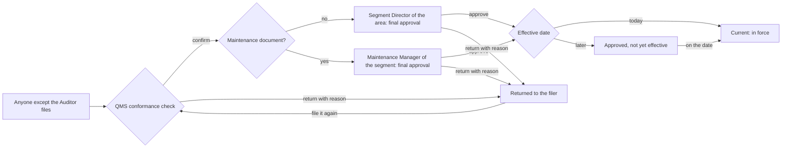

# 05 End-to-end workflow

The detailed rules are in `docs/BUSINESS-RULES.md` (§2, §7, §8, §9, §18, §19). This section walks through each path once, in order. Every step is **PROTOTYPE-PROVEN** (browser only) and **PRODUCTION CONTROL REQUIRED** (the server enforces the step, the identity, the time and the record).

## 1. The two approved routes (BD-02)

A document is "Maintenance" when its department is Maintenance or its type is Maintenance Bulletin (`BUSINESS-RULES.md` §3).

Only QMS files a Policy. *Production:* the final approver for Policy, Manual, Lesson Learned, Alert and any type not covered by these two routes is configured only after the business confirms the approval matrix (BD-02, 17 BC-01).

## 2. Filing

1. **Upload, one file, one document.** The filer chooses the area and type and, in an operational segment, Operations or Maintenance.
2. **Number.** The number is generated by TQ-QHSE-S001 §5.3, or typed and validated against it. It must be unused anywhere in the register, in any status. A withdrawn number is retired, not freed.
3. **Review step.** The filer sees the full record and who will give final approval, then files with an explicit Submit. Nothing is filed from an earlier step.
4. **The register stamps the filing.**
   - Status `draft`, stage `qms`.
   - The filer's identity and the time.
   - Any lifecycle field the caller sent is ignored.
5. **Classification and language.** The prototype always files `internal` and `en`. Who sets these at filing is **BUSINESS DECISION REQUIRED** (17).

## 3. QMS conformance check

- QMS checks the record, the numbering and the revision, from the QMS Workbench or the desk.
- **Confirm** moves it to final approval.
- **Return** needs a reason of at least 20 characters.
- QMS cannot check their own filing.
- Each decision is bound to the exact record QMS was shown. If the record changed in the meantime, the decision is refused and the page reloads (NEW-01).

## 4. Final approval

- The approver sees the number, the exact revision (and attempt), what it replaces, and a preview of that exact record. The approval dialog repeats them, with Cancel focused.
- **Approve** sets the approval date. The approver may choose a later **effective date**, but never an earlier one.
- The approver cannot be the filer or the QMS checker (separation of duties).
- *Production:* approval binds to the exact file version, using a trusted content fingerprint computed by the server at upload (PI-12). **PRODUCTION CONTROL REQUIRED.**

## 5. Rejection and re-filing

- A returned record keeps `draft`, is marked returned with who, when, at which step and why, and leaves both queues for good.
- "File it again" starts the next **attempt** of the same number and revision: Rev 1.0 (attempt 2), never a new revision. Each attempt is its own record with a permanent record id. The returned attempt keeps its history.

## 6. Revision

- Changing a document in force is a new controlled revision: same number, next revision (1.0 → 2.0). The register sets the revision. Type, area, department, scope, classification and translation link carry over.
- There is one open revision at a time, and **never more than one revision in force**.
- Final approval (or the effective date, when it is later) makes the new revision current and marks the old one superseded, in the same step. The old revision keeps every field it had.
- Translations in force are marked "to be re-issued" when their source is revised.

## 7. Future-effective approval

- Approved with a later date, the revision is "Approved, not yet effective".
- Until that date the old revision stays current and is the one Employees see.
- On the date the new revision becomes current and the old one superseded, once.
- *Production:* this needs a scheduled, idempotent promotion on the server's business date. **PRODUCTION CONTROL REQUIRED** (IT decides the mechanism).

## 8. Withdrawal

- QMS (any area), the Segment Director (own area, Operations) or the Maintenance Manager (own segment, Maintenance) may withdraw. A delegate may withdraw only if the grant includes "Manage documents".
- A reason of at least 20 characters is required. Who, when, why and the previous status are recorded on the record for good.
- Withdrawing the revision in force **cancels** any revision of it still in progress, and withdraws its translations in force, in the same step.
- Bulk withdrawal lists every revision affected, every open revision cancelled and every row left out (with the reason) before acting.
- A withdrawn document stays visible as "Withdrawn, do not use". Download, print, offline pin and the reference card are disabled. An exact-number search finds it, marked "Do not use" (PI-22).

## 9. Delegation

- The Segment Director or Maintenance Manager grants **approval** and/or **"Manage documents"** for their own area and department, optionally for chosen document types only. The grant runs from today or later, for at most 90 calendar days, with a reason of at least 20 characters.
- The grant is recorded with its evidence:
  - id;
  - grantor;
  - delegate;
  - permissions;
  - scope;
  - dates;
  - reason;
  - creator.
- Revocation is immediate, and records who and when. Grants are never deleted.
- An action under a grant records the actor, the grant and the grantor separately.
- *Production:* the delegate is chosen from Entra ID and signs in as themselves. Grants are evaluated by the server. **PRODUCTION CONTROL REQUIRED.**

## 10. Reading

- Readers see documents in force for their role (classification-trimmed, BD-03). Withdrawn and superseded documents are marked "do not use".
- The document page states the status, revision, issued date, approval, review and classification. It says "Current, OK to use" only for a `current` document, and to verify the revision in SCORE before use (BD-01).
- Links, share links and QR codes carry the document number and the record's own area (PI-23).

## 11. Offline (BD-05)

- Pages already opened stay readable offline.
- Every change is refused while RISE cannot be reached; nothing is queued.
